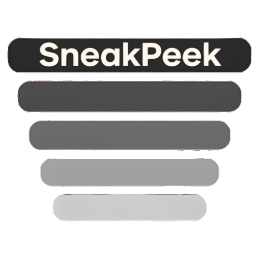
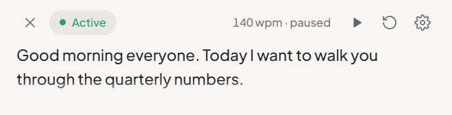
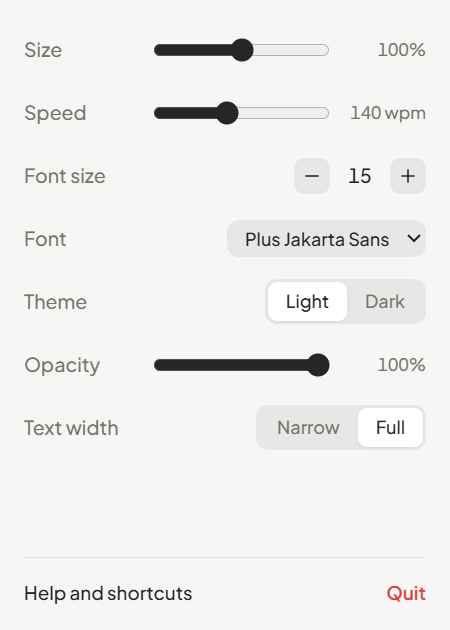
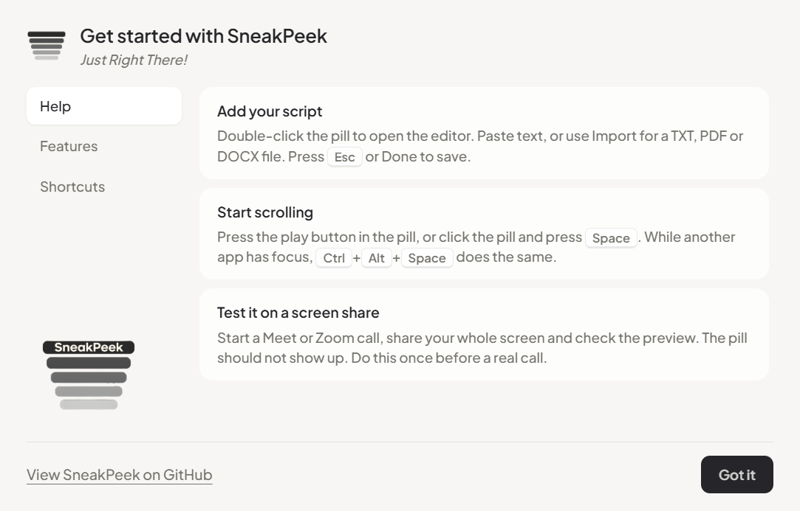

<p align="center">
  
</p>

# SneakPeek

*Just Right There!*

[](#install)
[](https://www.electronjs.org/)
[](#how-it-hides)
[](#features)
[](https://github.com/saijishnup/SneakPeek/releases)

---

## What it is

A small teleprompter pill that sits on top of everything and does not show up in screen shares, screenshots or recordings. Read your script on a Meet call without anyone seeing it.

<p align="center">
  
</p>

## Features

- **Hidden from capture:** Meet, Zoom, Teams, OBS, PrintScreen, Win+Shift+S, Game Bar.
- **Always on top:** above full-screen apps, re-pins itself if bumped.
- **Auto-scroll:** 30–300 wpm, play button or <kbd>Space</kbd>, global <kbd>Ctrl</kbd>+<kbd>Alt</kbd>+<kbd>Space</kbd>.
- **Import:** TXT, PDF (text layer) and DOCX.
- **Adjustable:** size 60–140%, font 6–40 px, opacity, light/dark, narrow text width.
- **Mini pill:** <kbd>Esc</kbd> collapses it, <kbd>Esc</kbd> again restores.

| Settings | Help |
|---|---|
|  |  |

## How it hides

```
BrowserWindow ──► setContentProtection(true)
              ──► SetWindowDisplayAffinity(WDA_EXCLUDEFROMCAPTURE)
              ──► compositor drops the window from every capture path
```

A phone camera pointed at the screen still sees it.

## Shortcuts

| Key | Action |
|---|---|
| <kbd>Space</kbd> | Start / stop scrolling |
| <kbd>+</kbd> / <kbd>-</kbd> | Speed ±10 wpm |
| <kbd>Ctrl</kbd>+<kbd>R</kbd> | Back to top |
| <kbd>Ctrl</kbd>+<kbd>Alt</kbd>+<kbd>Space</kbd> | Start / stop from any app |
| Double-click | Edit script |
| <kbd>Esc</kbd> | Leave edit / mini pill |

## Install

Download `SneakPeek Setup x.y.z.exe` from [Releases](https://github.com/saijishnup/SneakPeek/releases) and run it. It installs per user, no admin needed.

## Run from source

```bash
git clone https://github.com/saijishnup/SneakPeek.git
cd SneakPeek
npm install
npm start
```

| Command | Does |
|---|---|
| `npm test` | Importer unit tests |
| `npm run smoke` | Window flags (on top, protected) |
| `npm run e2e` | Drives the real app end to end |
| `npm run dist` | Builds the installer into `dist/` |
